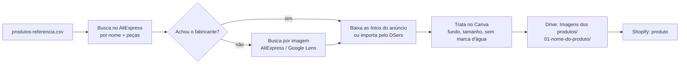

# Plano de busca de imagens (VS Code + Copilot + Canva)

Este plano usa o blocobox.com só como **lista de modelos**: quais produtos vender, número de peças e tamanho.
Nenhuma imagem, vídeo ou texto do blocobox.com entra na loja.
As imagens vêm do fornecedor que fabrica cada modelo.

## Arquivos do plano

| Arquivo | Para que serve |
| --- | --- |
| `midia/produtos-referencia.csv` | Lista com 32 modelos, peças, tamanho, coleção, preço de referência e links de busca prontos |
| Pasta do Drive **Imagens dos produtos** | Onde as imagens finais ficam salvas, uma subpasta por produto |

Pasta do Drive: https://drive.google.com/drive/folders/13XcITqpTMQvgxAtGaww1xE3LUi9nVeX3

## Fluxo

## De onde vêm as imagens

| Fonte | Uso | Motivo |
| --- | --- | --- |
| **AliExpress e CJ Dropshipping** | **Fonte principal das fotos** | São os anúncios do fabricante. Revendedores podem usar as fotos. É de lá que você compra. |
| **Minha loja no Mercado Livre** | **Fonte permitida** | Só as fotos próprias: tiradas por você, artes suas ou fotos do fornecedor que você pode usar. |
| **Amazon** | Só para pesquisa de preço e de nomes | As fotos dos anúncios são dos vendedores. Não baixe. |
| **Mercado Livre (outros vendedores)** | Só para pesquisa de preço e de concorrência | As fotos são dos vendedores. Não baixe. |

Se a mesma foto do fabricante aparecer na Amazon ou no Mercado Livre, baixe pelo anúncio do fabricante no AliExpress.

### Fotos da minha loja no Mercado Livre

1. Use os arquivos originais do computador ou do celular. As fotos baixadas do anúncio vêm comprimidas.
2. Não use fotos copiadas de outros vendedores.
3. Tire selos, textos ("Frete grátis", "Full"), marcas d'água e o nome da loja do Mercado Livre.
4. Combine por escrito com o cliente que ele pode usar essas fotos na loja BlocodeMontar.
5. Salve na subpasta do produto no Drive e marque `importado` na coluna `status` do CSV.

## Etapa 1: preparar o VS Code (uma vez)

1. Instale a extensão **Rainbow CSV** para ler o `midia/produtos-referencia.csv` com colunas coloridas.
2. Instale o **Google Drive para computador**. Ele cria a unidade `G:` no Windows.
3. Confirme que a pasta existe: `G:\Meu Drive\BlocodeMontar\Imagens dos produtos`.
4. Peça ao Copilot (modo Agent):
   > "Leia `midia/produtos-referencia.csv` e crie uma subpasta para cada valor da coluna `pasta_drive` dentro de `G:\Meu Drive\BlocodeMontar\Imagens dos produtos`. Use PowerShell."

## Etapa 2: buscar o fornecedor de cada modelo

Para cada linha do CSV:

1. Abra o link da coluna `busca_aliexpress` (Ctrl + clique no VS Code).
2. Escolha o anúncio que bate com o **número de peças** e o **tamanho**.
3. Prefira anúncios com muitas vendas, nota acima de 4,7 e fotos sem marca d'água.
4. Se a busca por nome não achar, use a busca por imagem do AliExpress (ícone de câmera) com uma foto de referência do modelo.
5. Abra os links de `busca_amazon` e `busca_mercadolivre` só para anotar o preço da concorrência.
6. Preencha no CSV as colunas `link_fornecedor_escolhido`, `custo_fornecedor` e `status` (`encontrado`, `sem fornecedor` ou `importado`).

Peça ao Copilot quando terminar um grupo:
> "Mostre as linhas do `midia/produtos-referencia.csv` com status diferente de `encontrado` ou `importado`."

## Etapa 3: baixar as imagens do fornecedor

O caminho mais rápido é **importar pelo DSers**, porque ele baixa as fotos e o vídeo do anúncio direto para a Shopify.

Para guardar uma cópia no Drive:
1. No anúncio do AliExpress, abra cada foto do produto em tamanho grande.
2. Salve na subpasta do produto no Drive, com nomes em ordem: `01.jpg`, `02.jpg`, `03.jpg`.
3. Salve o vídeo do anúncio, quando existir, como `video.mp4`.

Peça ao Copilot depois de baixar:
> "Na pasta `G:\Meu Drive\BlocodeMontar\Imagens dos produtos`, liste as subpastas sem nenhuma imagem."

## Etapa 4: tratar as imagens no Canva

O Copilot não controla o Canva. Este passo é manual, no navegador ou no app do Canva.

1. Crie um design de **1200 x 1200 px**.
2. Envie as fotos da subpasta do produto.
3. Use **Removedor de fundo** e coloque fundo branco ou cinza claro (`#F4F5F9`).
4. Apague marcas d'água e textos em chinês com **Borracha mágica**.
5. Exporte em JPG, qualidade 80, e salve na subpasta com o sufixo `-final`: `01-final.jpg`.

Para os banners da home, use os tamanhos do `PLANO-MIDIA.md`, etapa 3.

Dica: no Canva, a função **Criar em massa** gera um banner por produto a partir de uma planilha. Use as colunas `produto`, `pecas` e `tamanho` do CSV.

## Etapa 5: conferir antes de subir na Shopify

Peça ao Copilot:
> "Crie um script PowerShell que confira cada subpasta de `Imagens dos produtos`: pelo menos 3 arquivos `-final.jpg`, cada um com menos de 300 KB. Mostre uma tabela com o resultado."

Depois envie as imagens `-final` para cada produto na Shopify, ou deixe as do DSers e troque só as que tiverem marca d'água.

## Cuidado com marcas registradas

Vários modelos usam marcas de terceiros (equipes de Fórmula 1, Disney, Star Wars, Harry Potter, Nintendo, carros).
Vender réplicas não licenciadas com essas marcas pode gerar notificação dos donos das marcas e bloqueio de anúncios no Google e na Meta.
Combine com o cliente como ele quer tratar isso: por exemplo, usar nomes descritivos ("Carro de corrida prateado 1642 peças") no lugar das marcas.

## Checklist

- [ ] Subpastas criadas no Drive
- [ ] Fornecedor encontrado para cada modelo (coluna `status`)
- [ ] Fotos do fornecedor salvas no Drive
- [ ] Fotos tratadas no Canva (`-final.jpg`)
- [ ] Nenhuma imagem baixada do blocobox.com, da Amazon ou de outros vendedores do Mercado Livre
- [ ] Produtos importados e com fotos na Shopify
