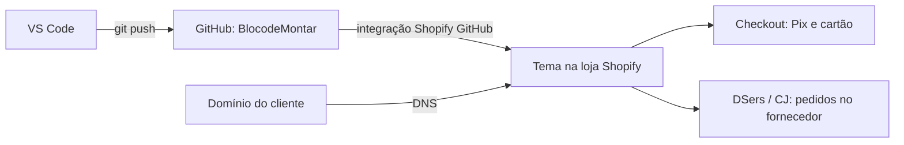

# Guia de publicação da loja BlocodeMontar

Este documento lista os passos para colocar a loja no ar, as contas e integrações necessárias e o que pedir ao cliente.

## 1. Onde a loja fica hospedada

A loja usa a **Shopify**, que já é a hospedagem paga.
Não é preciso contratar servidor, VPS ou hospedagem separada.
O plano da Shopify inclui servidor, SSL (cadeado https), CDN, checkout seguro e backups.

O tema fica no GitHub e é ligado à loja pela integração **Shopify GitHub**.
Cada `git push` no branch `main` atualiza o tema na loja.

## 2. O que pedir ao cliente

### 2.1 Dados da empresa
- [ ] Razão social e nome fantasia
- [ ] CNPJ (ou CPF, se ainda for MEI em abertura)
- [ ] Endereço comercial completo (aparece nas políticas e no checkout)
- [ ] E-mail de atendimento (de preferência no domínio, por exemplo `contato@blocodemontar.com.br`)
- [ ] Número de WhatsApp comercial
- [ ] Horário de atendimento

### 2.2 Identidade visual
- [ ] Logotipo em PNG transparente (ou SVG)
- [ ] Ícone para o favicon (quadrado)
- [ ] Cores da marca, se forem diferentes do amarelo `#FFC20E` e azul-marinho `#1B1F3B`
- [ ] Links das redes sociais (Instagram, TikTok, Threads, Facebook, YouTube)

### 2.3 Contas que o cliente cria no nome dele
O cliente é o dono de todas as contas. Você entra como colaborador.

| Conta | Para que serve | O que o cliente precisa |
| --- | --- | --- |
| Shopify (plano Basic) | Loja, hospedagem e checkout | E-mail, cartão de crédito internacional para a mensalidade |
| Domínio (Registro.br para `.com.br`) | Endereço da loja | CPF ou CNPJ, pagamento anual |
| Gateway de pagamento (Mercado Pago, Appmax ou Yampi) | Pix e cartão parcelado | CNPJ ou CPF, documento com foto, conta bancária para receber |
| DSers ou CJ Dropshipping | Importar produtos e enviar pedidos ao fornecedor | E-mail; no DSers, também uma conta AliExpress |
| AliExpress (se usar DSers) | Comprar do fornecedor | Cartão para pagar os pedidos aos fornecedores |
| Google (Analytics e Merchant Center) | Medir visitas e anunciar no Google Shopping | Conta Google da empresa |
| Meta Business (Facebook e Instagram) | Pixel de conversão e loja no Instagram | Página da empresa no Facebook e conta comercial no Instagram |
| Reclame Aqui | Selo de confiança no rodapé | Cadastro da empresa |

### 2.4 Regras comerciais (o cliente decide)
- [ ] Desconto no Pix (padrão do tema: 10%)
- [ ] Parcelas sem juros (padrão do tema: 6x) e valor mínimo da parcela
- [ ] Cupons e porcentagens (por exemplo `BEMVINDO10` na primeira compra)
- [ ] Cashback: porcentagem e app (ou retirar o aviso da barra de topo)
- [ ] Frete: grátis, tabela fixa ou acima de um valor
- [ ] Margem de lucro sobre o custo do fornecedor
- [ ] Prazo de entrega que a loja vai informar

### 2.5 Textos legais
- [ ] Política de troca e devolução (o Código de Defesa do Consumidor garante 7 dias para compras online)
- [ ] Política de privacidade (LGPD)
- [ ] Termos de uso
- [ ] Política de frete
- [ ] Texto "Quem somos"

A Shopify gera modelos em **Configurações > Políticas**. O cliente deve revisar os textos com um advogado ou contador.

## 3. Acessos que você precisa receber

- [ ] **Acesso de colaborador** na loja do cliente (Shopify Partners > Lojas > Adicionar loja > Loja gerenciada). Não peça a senha do cliente.
- [ ] Acesso ao painel do domínio para mudar o DNS, ou o cliente faz esse passo com o seu roteiro
- [ ] Conta do gateway: o cliente instala e conecta o app com você acompanhando
- [ ] Convite de administrador no Meta Business e no Google Analytics

Guarde senhas e chaves em um gerenciador de senhas (por exemplo Bitwarden). Nunca coloque senhas ou chaves no GitHub.

## 4. Integrações (apps e APIs)

A Shopify faz a ligação com cada serviço pelo app oficial. Não é preciso programar APIs.

| Integração | App na Shopify | Chave ou dado necessário |
| --- | --- | --- |
| Pagamento Pix e cartão | Mercado Pago, Appmax ou Yampi | Login na conta do gateway (o app gera as chaves sozinho) |
| Dropshipping | DSers ou CJ Dropshipping | Login do DSers + conta AliExpress, ou login do CJ |
| Avaliações com fotos | Judge.me | Nenhuma (instala e importa avaliações) |
| Rastreio | Já está no tema (página `/pages/rastrear-pedido` com 17Track) | Nenhuma. Opcional: app 17TRACK para e-mails automáticos |
| Google Analytics 4 | Google & YouTube | Conta Google e ID de medição `G-XXXX` |
| Meta Pixel e catálogo | Facebook & Instagram | Meta Business, pixel e catálogo |
| E-mail marketing | Shopify Email (grátis até um limite) | Nenhuma |
| WhatsApp | Já está no tema | Número com DDI e DDD nas configurações do tema |

## 5. Passo a passo para publicar

### Fase 1: loja do cliente
1. O cliente cria a conta Shopify e escolhe o plano Basic.
2. O cliente envia o convite de colaborador para você.
3. Em **Configurações > Loja**, preencha nome, e-mail, endereço, moeda (BRL) e fuso horário (Brasília).
4. Em **Configurações > Idiomas**, defina português (Brasil) como idioma padrão.

Alternativa: se você montar tudo na loja de desenvolvimento `bloco-de-montar-dev`, transfira a posse para o cliente em **Shopify Partners > Lojas > Transferir posse**. O cliente escolhe o plano pago na transferência.

### Fase 2: tema
1. Em **Loja virtual > Temas > Adicionar tema > Conectar do GitHub**, escolha `marleyrosa/BlocodeMontar`, branch `main`.
2. Publique o tema.
3. Siga o `GUIA-LOJA.md` para configurar cores, logotipo, WhatsApp, CNPJ, coleções, menus e campos de produto.
4. Siga o `PLANO-MIDIA.md` para fotos, banners e vídeos.

### Fase 3: produtos e fornecedor
1. Instale DSers ou CJ Dropshipping e conecte a conta.
2. Importe os 15 primeiros produtos com fotos e vídeos do fornecedor.
3. Ajuste preços, peças, escala e dimensões.
4. Coloque os produtos nas coleções.
5. Crie os produtos "Caixa de presente" e "Organizador de peças" para o "leve junto".

### Fase 4: pagamento e frete
1. Instale o app do gateway escolhido e conecte a conta do cliente.
2. Configure o desconto de 10% no Pix e as 6x sem juros **no gateway** (o tema só mostra o preço).
3. Em **Configurações > Frete e entrega**, crie as tarifas de frete.
4. Crie os cupons em **Descontos**.

### Fase 5: domínio
1. Em **Configurações > Domínios > Conectar domínio**, digite o domínio do cliente.
2. No painel do domínio (por exemplo Registro.br), crie os registros que a Shopify mostrar. Normalmente:
   - Registro **A** do domínio principal (`@`) para `23.227.38.65`
   - Registro **CNAME** de `www` para `shops.myshopify.com`
   Use sempre os valores que a Shopify mostrar na tela, porque eles podem mudar.
3. Espere a propagação (de alguns minutos a 48 horas).
4. Defina o domínio como principal. A Shopify ativa o SSL sozinha.

### Fase 6: e-mail e notificações
1. Em **Configurações > Notificações**, traduza e revise os e-mails de pedido, envio e rastreio.
2. Configure o e-mail do remetente com o domínio do cliente e autentique (a Shopify mostra os registros DNS).

### Fase 7: rastreamento e anúncios
1. Instale **Google & YouTube** e conecte o Analytics 4 e o Merchant Center.
2. Instale **Facebook & Instagram** e conecte o pixel e o catálogo.
3. Instale o **Judge.me** e importe as avaliações dos produtos do fornecedor.

### Fase 8: testes antes de abrir
- [ ] Ative o modo de teste do gateway e faça um pedido com Pix e outro com cartão
- [ ] Teste um cupom no checkout
- [ ] Confira se o pedido aparece no DSers/CJ
- [ ] Teste o botão de WhatsApp no produto (mensagem com o SKU)
- [ ] Teste a página de rastreio
- [ ] Abra a loja no celular e no computador
- [ ] Confira as políticas no rodapé
- [ ] Rode o PageSpeed Insights na home e na página de produto

### Fase 9: abrir a loja
1. Em **Loja virtual > Preferências**, desmarque **Proteção por senha**.
2. Faça um pedido real pequeno e cancele com reembolso.
3. Entregue ao cliente o treinamento básico do painel (proposta, Fase 4).

## 6. Custos mensais do cliente

| Item | Valor aproximado | Frequência |
| --- | --- | --- |
| Shopify Basic | cerca de US$ 29 (menos no plano anual) | Mensal |
| Domínio `.com.br` | cerca de R$ 40 | Anual |
| Taxa por transação | depende do gateway (Pix costuma ser menor que cartão) | Por venda |
| Apps pagos (opcionais) | de US$ 0 a US$ 30 cada | Mensal |

Confira os preços atuais em cada site antes de passar o orçamento ao cliente.

## 7. Resumo: mensagem para enviar ao cliente

> Olá! Para colocar a loja BlocodeMontar no ar, preciso que você me envie:
> 1. Razão social, CNPJ, endereço, e-mail e WhatsApp de atendimento.
> 2. Logotipo (PNG transparente) e links das redes sociais.
> 3. O domínio desejado (ou acesso ao painel do domínio, se já tiver um).
> 4. A criação, no seu nome, das contas Shopify (plano Basic), gateway de pagamento (Mercado Pago, Appmax ou Yampi) e DSers ou CJ Dropshipping. Eu te mando o passo a passo de cada uma.
> 5. As regras comerciais: desconto no Pix, parcelas, frete, cupons e margem de lucro.
> 6. A aprovação dos textos de troca, privacidade e termos de uso.
>
> Depois disso, eu te envio um convite de colaborador para acessar a loja sem precisar da sua senha.
